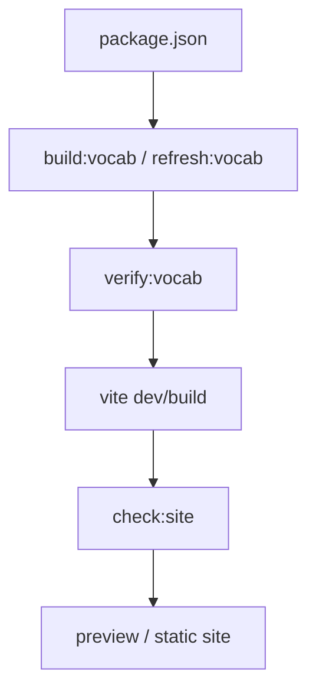

# VocabularyKing Flowchart

主要流程

- 入口由 `package.json` 驅動。
- `build:vocab` 先生成詞彙資料。
- `verify:vocab` 檢查資料一致性。
- `check:site` 串起測試、驗證與站點建置。

重要分支 / 風險

- 生成資料若過舊，會直接影響站點內容。
- `predev` / `prebuild` 代表 vocab 生成是前置步驟。

依據檔案

- `AGENTS.md`
- `package.json`
- `index.html`
- `TODO.md`
